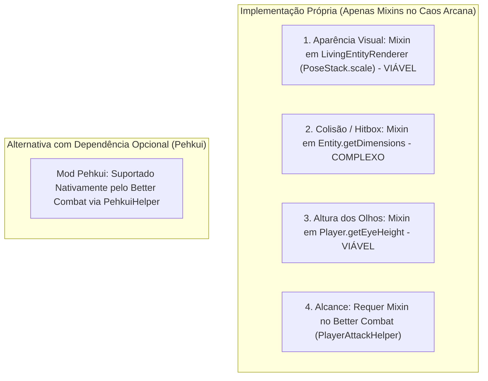

# Conciliação Documental: Novo Material de Design vs. Caos Arcana Atual

> **Data de Elaboração:** 28/10/2026  
> **Status:** Documento Consultivo de Análise de Impacto e Alinhamento Prévio  
> **Finalidade:** Comparar a documentação mestra e o código da branch `feat/races-spells-balance-v1` com o material de design externo não versionado fornecido pelo usuário, preservando a governança, as raças persistidas e o trabalho em andamento.

---

## 1. Catálogo das Referências Visuais Recebidas

As 10 imagens de referência armazenadas localmente fora do repositório foram catalogadas como **pranchas conceituais ilustrativas de referência (2048 × 1152)**.  
> [!WARNING]
> **Classificação de Governança:** Estas imagens representam **estudos de conceito visual**. Não são arquivos de textura UV desdobrada (`.png` de skin/textura para malha), não são modelos 3D instaláveis (`.bbmodel` ou `.json`) e não constituem arte final aprovada para empacotamento no mod.

| Arquivo | Raça Representada | Resolução / Tamanho | Escala Conceitual Sugerida | Classificação Técnica |
| :--- | :--- | :--- | :--- | :--- |
| `01_humano.png` | Humano | 2048 × 1152 (4,86 MB) | 1,80 m (`1.000x`) | Prancha conceitual 2D/3D (Referência de Proporções) |
| `02_elfo_floresta.png` | Elfo da Floresta (Bosmer) | 2048 × 1152 (4,91 MB) | 1,72 m (`0.955x`) | Prancha conceitual 2D/3D (Referência de Proporções) |
| `03_alto_elfo_elara.png` | Alto Elfo (Altmer - Elara) | 2048 × 1152 (4,90 MB) | 1,98 m (`1.100x`) | Prancha conceitual 2D/3D (Referência de Proporções) |
| `04_orc.png` | Orc (Orsimer) | 2048 × 1152 (4,81 MB) | 2,05 m (`1.138x`) | Prancha conceitual 2D/3D (Referência de Proporções) |
| `05_felino.png` | Felino (Khajiit) | 2048 × 1152 (5,20 MB) | 1,78 m (`0.988x`) | Prancha conceitual 2D/3D (Referência de Proporções) |
| `06_nordico.png` | Nórdico (Nord) | 2048 × 1152 (4,62 MB) | 1,92 m (`1.066x`) | Prancha conceitual 2D/3D (Referência de Proporções) |
| `07_sangue_daedra.png` | Sangue-Daedra (Dremora) | 2048 × 1152 (4,58 MB) | 1,96 m (`1.089x`) | Prancha conceitual 2D/3D (Referência de Proporções) |
| `08_redguard.png` | Guardião Vermelho (Redguard) | 2048 × 1152 (4,60 MB) | 1,82 m (`1.011x`) | Prancha conceitual 2D/3D (Referência de Proporções) |
| `09_argoniano.png` | Argoniano (Argonian) | 2048 × 1152 (2,49 MB) | 1,84 m (`1.022x`) | Prancha conceitual 2D/3D (Referência de Proporções) |
| `10_voidmer.png` | Elfo do Vazio (Voidmer) | 2048 × 1152 (2,24 MB) | 1,95 m (`1.083x`) | Prancha conceitual 2D/3D (Referência de Proporções) |

---

## 2. Matriz de Diferenças e Conflitos de Regras

A tabela a seguir compara sistematicamente o estado atual (código Java em `caos-arcana-mod` e documentos homologados) com o novo documento de design (`DOCUMENTO_DESIGN_E_PROMPT_IMPLEMENTACAO.md`).

| Tópico | Regra Atual (Código / Docs Homologados) | Nova Proposta de Design | Origem da Informação | Sistemas Afetados | Decisão Necessária do Usuário |
| :--- | :--- | :--- | :--- | :--- | :--- |
| **Elenco e Identificadores de Raças** | 10 raças canônicas Skyrim em `Race.java`: `NONE`, `ORC` (`"orc"`), `FELINO` (`"felino"`), `ALTO_ELFO` (`"alto_elfo"`), `NORDICO` (`"nordico"`), `ELFO_NEGRO` (`"elfo_negro"`), `ELFO_FLORESTA` (`"elfo_floresta"`), `BRETAO` (`"bretao"`), `IMPERIAL` (`"imperial"`), `GUARDA_VERMELHO` (`"guarda_vermelho"`), `ARGONIANO` (`"argoniano"`). | Propõe substituir `bretao` por `sangue_daedra`, substituir `elfo_negro` por `voidmer`, renomear `imperial` para `humano` e `guarda_vermelho` para `redguard`. | Seção 1 e Seção 4 do novo documento. | `Race.java`, NBT de jogadores existentes (`rpg_player_data`), comandos (`/caos status`), telas de GUI e testes unitários. | **Decisão 1:** Aprovar ou rejeitar a troca de raças (Sangue-Daedra e Voidmer no lugar de Bretão e Dunmer) e a renomeação de IDs. Se aprovado, definir rotina de migração para saves antigos. |
| **Exceção do Humano para Equipamentos** | `EquipmentRequirement.check()` valida estritamente `allowedRaces.contains(playerRace)`. Violação bloqueia equipar para qualquer raça. | Humano tem a passiva *Versatilidade*: pode ignorar exclusivamente o requisito racial de equipamentos Tiers 1 a 3 (T1–T3). | Seção 2 e 4 (Raça 01) do novo documento. | `EquipmentRequirement.java`, `EquipmentRequirementRegistry.java`, `EquipmentValidationHandler.java`. | **Decisão 2 (Aprovada em 28/10/2026):** Aprovado o bypass restrito a T1–T3 de requisito racial. Não ignora nível, proficiência, Soulbound ou outros requisitos; não concede poderes raciais ou bônus de conjunto; vedado a T4 de outras raças; sem bypass em itens sem tier explícito. Números e catálogo de tiers permanecem não aprovados. |
| **Imunidades, Vulnerabilidades e Regras Ambientais** | Apenas Argoniano tem mecânica diferenciada ativa (1/3 de gasto de oxigênio em `LivingEntityRPGMixin`). Demais bônus são modificadores vanilla de vida, dano, velocidade e armadura. | Mobs do Nether neutros com Sangue-Daedra; Endermen/Shulkers neutros com Voidmer; Afogados/Guardiões neutros com Argoniano; debuffs táticos no PvP (*Resfriamento Abissal*, *Fadiga Astral*, *Pele Hidratada*). | Seção 1 e Seção 2 do novo documento. | IA de Mobs (Mixins de Target), eventos de dano e poções, tick de ambiente de jogador. | **Decisão 3:** Definir se a neutralidade de mobs e debuffs PvP avançados entram no escopo atual ou se ficam para uma fase posterior de PvE/PvP. |
| **Quatro Tiers de Equipamentos e Bônus de Conjunto** | Infraestrutura com 3 itens provisórios apenas (`iron_chestplate`, `golden_boots`, `diamond_helmet`). Não há tiers, armas ou bônus de conjunto cadastrados. | 4 Tiers formais (Fraco, Médio, Forte, Lendário) para armaduras e armas de cada raça (80 itens novos), bônus de conjunto de 4 peças e 2 encantamentos exclusivos por raça. | Seção 3 e Seção 4 do novo documento. | `EquipmentRequirementRegistry`, criação de itens em `ModItems`, receitas, balanceamento e inventários. | **Decisão 4:** Aprovar o modelo de 4 Tiers como especificação oficial para quando a criação de itens for iniciada. |
| **Mecânica Soulbound** | Não existe Soulbound. O Caos Arcana possui apenas *Custódia Segura* (Pending Deliveries) para guardar peças desequipadas automaticamente sem perda ou drop no chão. | Itens Tier 4 Lendários são declarados como *Soulbound Racial* (intransferíveis, exclusivos da raça dona). | Seção 3 (Tabela de Tiers) do novo documento. | Sistema de morte do jogador, drops, baús, comércio e eventos de inventário. | **Decisão 5:** Definir as regras de Soulbound: o item desaparece ao morrer, fica trancado no inventário ou pode ser guardado em baús privados? |
| **Três Habilidades Ativas por Raça** | Cada raça possui 1 poder racial registrado documentalmente e 1 magia ativa selecionável para a tecla `V` via `SpellCastHandler`. | 3 habilidades ativas por raça: Habilidade 1, Habilidade 2 e Suprema (30 habilidades no total). | Seção 2 e 4 do novo documento. | Sistema de input do cliente (`KeyMapping`), pacotes C2S, HUD de recargas e `SpellCastHandler`. | Definir se a expansão para 3 teclas ativas substitui o modelo de seleção única por menu `R`. |
| **Escala, Hitbox, Câmera e Alcance** | Todos os jogadores possuem altura vanilla fixa (1,80 m) e hitbox padrão (0,6 × 1,8 blocos). Sem modificadores de escala. | Escalas entre 1,72 m (`0.955x`) e 2,05 m (`1.138x`), com hitbox proporcional e impacto direto no alcance e mira. | Seção 2 e 4 do novo documento. | Dimensões de entidade, altura de câmera dos olhos, colisão física, renderizador e integração com Better Combat. | Ver viabilidade técnica abaixo (seção 4). |

---

## 3. Avaliação Técnica do Lote B (Better Combat)

A avaliação preliminar do Better Combat e suas dependências foi realizada no ambiente isolado `caos-arcana-mod/run/teste_lote_b/`, com os seguintes níveis de evidência estritamente separados:

1. **Inicialização Executada (Aprovada):**
   * Servidor dedicado inicializou em 4,68s com `bettercombat-fabric-1.9.0+1.20.1.jar`, `player-animation-lib-fabric-1.0.2-rc1+1.20.jar`, `cloth-config-11.1.136-fabric.jar`, `fabric-api-0.92.12+1.20.1.jar` e `caosarcana-1.0.0-alpha.jar`.
   * Cliente conectou com sucesso via `localhost:25565` (`TesteLoteB joined the game`).
   * Registry de armas do Better Combat codificado e sincronizado via rede (8.234 bytes).
2. **Inspeção de Código (Concluída):**
   * O Better Combat executa o ataque final no servidor via `player.attack(targetEntity)`. Os modificadores raciais existentes de `Attributes.ATTACK_DAMAGE` são herdados naturalmente no dano de combate.
   * O Better Combat escuta pacotes C2S na rede (`Packets$C2S_AttackRequest`) e **não passa pelo evento vanilla `AttackEntityCallback`**.
3. **Teste de Gameplay Executado (Concluído em Bancada):**
   * Aprendizado de magia (`/caos learn "caosarcana:centelha_ignea"`) e disparo de feitiço com armas empunhadas funcionaram normalmente sem conflito de teclas (`V` para magia, botão esquerdo para Better Combat).
   * Validação de armadura existente no Caos Arcana continua desequipando armaduras violadas e enviando mensagem no chat do cliente.
4. **Integração de Requisitos de Armas (Pendente de Prova de Conceito):**
   * **Fato Concreto:** Não existe nenhuma arma cadastrada no `EquipmentRequirementRegistry` atual (apenas armaduras).
   * **Classificação Formal:** A integração de armas está **PENDENTE DE PROVA DE CONCEITO**. Não foi realizado bypass prático demonstrado, pois nenhuma restrição de arma estava ativa para ser violada.
5. **Menor Ponto de Integração Proposto no Servidor (Sem Desarme Forçado):**
   * Para não impedir o transporte de armas no inventário nem inviabilizar o comércio (`RequirementType.TRADE`), o ponto ideal de validação no servidor é no manipulador do pacote `C2S_AttackRequest` do Better Combat:
     1. Identificar qual mão está deferindo o golpe (`hand.isOffHand() ? player.getOffhandItem() : player.getMainHandItem()`).
     2. Consultar `EquipmentRequirementRegistry.canEquip(player, attackingStack)`.
     3. Se for desautorizado para aquela raça ou nível: **cancelar o processamento do pacote de ataque** e emitir som de recusa (`VILLAGER_NO`) com mensagem no chat.
     4. A arma permanece na mão do jogador normalmente, permitindo que ele a transporte, guarde em baús ou venda, mas **sem conseguir causar dano**.

---

## 4. Viabilidade Técnica de Escala no Minecraft 1.20.1 (Sem Dependências Extras)

Nas versões oficiais de Minecraft:
* O atributo genérico de escala (`generic.scale`) **só foi introduzido oficialmente no Minecraft 1.20.5 / 1.21**.
* No **Minecraft 1.20.1**, o motor vanilla **não possui atributo nativo de escala**.

Abaixo detalhamos o que é viável alterar por conta própria via Mixin sem adicionar novas dependências, separando claramente cada camada:

1. **Aparência Visual Pura (Fácil e Seguro):**
   * Feita através de um Mixin em `LivingEntityRenderer` aplicando `matrixStack.scale(scale, scale, scale)`.
   * **Limitação:** Altera apenas o modelo que o jogador e os outros veem. Não muda o tamanho do bloco onde o jogador passa, não muda a caixa de clique e não muda a visão.
2. **Hitbox e Colisão Física (Médio / Alto Risco):**
   * Exige Mixin em `Entity.getDimensions(Pose)` para retornar largura e altura multiplicadas pela escala da raça.
   * Se a hitbox aumentar (ex: Orc 2,05 m), o jogador pode entalar em portas normais de 2 blocos de altura ou tetos baixos. Se diminuir (Elfo 1,72 m), consegue passar por vãos menores.
3. **Câmera / Altura dos Olhos (Médio):**
   * Exige Mixin em `Player.getEyeHeight(Pose, EntityDimensions)` para elevar ou baixar a câmera conforme a escala, evitando que a visão fique dentro do peito de raças altas ou acima da cabeça de raças baixas.
4. **Alcance de Ataque no Better Combat:**
   * O Better Combat possui suporte integrado condicional ao mod **Pehkui** (`net.bettercombat.client.compat.PehkuiHelper`). Se o mod Pehkui estiver presente, o Better Combat já ajusta o alcance de ataque e a colisão automaticamente.
   * Se o Caos Arcana **não** usar o Pehkui, terá que injetar um Mixin próprio dentro de `PlayerAttackHelper` do Better Combat para aplicar o multiplicador de alcance da raça.

---

## 5. Status das Decisões Estratégicas (Atualizado em 28/10/2026)

1. **Elenco e Migração de Raças: [APROVADO EXCLUSIVAMENTE PELO USUÁRIO EM 28/10/2026]**
   * Aprovado o novo elenco de 10 raças: Humano, Elfo da Floresta, Alto Elfo, Orc, Felino, Nórdico, Sangue-Daedra, Redguard, Argoniano e Voidmer.
   * *Compatibilidade acordada:* `imperial` e `guarda_vermelho` têm migração transparente. `bretao` e `elfo_negro` recebem re-escolha livre na interface sem conversão forçada. Conhecimentos, níveis, inventário e recargas são preservados. Equipamentos sem requisitos usam a Custódia Segura.
   * *Bloqueio preventivo na migração:* Personagens aguardando nova seleção racial ficam terminantemente impedidos de ativar poderes da raça antiga. Todos os dados para conclusão sem perdas permanecem intactos.
   * *Nenhuma alteração de código ou saves foi implementada nesta etapa.*
2. **Exceção de Equipamento para Humanos (Versatilidade): [APROVADO PELO USUÁRIO EM 28/10/2026]**
   * **Bypass exclusivo de raça para T1–T3:** O Humano pode ignorar exclusivamente o requisito racial de equipamentos Tier 1, Tier 2 e Tier 3.
   * **Inviolabilidade de outros requisitos:** Não ignora Nível Geral, proficiência de escola, vínculo ao proprietário (Soulbound) ou outros requisitos.
   * **Sem poderes ou bônus de conjunto:** Não recebe poderes raciais intrínsecos nem bônus de conjunto exclusivos de outra raça ao usar a peça.
   * **Vedação a T4:** Não pode usar itens Tier 4 exclusivos de outras raças sob nenhuma hipótese.
   * **Sem bypass em itens sem tier:** Equipamentos sem tier cadastrado não recebem bypass automático.
   * *Delimitação:* Não aprova valores de atributos de equipamentos, catálogo completo de tiers ou o sistema Soulbound.
3. **Diretriz de Escala no Minecraft 1.20.1: [PENDENTE DE DECISÃO]**
   * Decidir entre escala puramente visual, física completa (hitbox e câmera) ou integração com Pehkui.
4. **Política de Restrição de Armas com Better Combat: [CONCLUÍDO E VALIDADO EM POC]**
   * PoC concluída com sucesso no Lote B: o ataque é bloqueado em `Player.attack` com feedback sonoro/chat, mantendo o item em mãos e no inventário. Regra de teste permanece desativada por padrão.
5. **Kit de Habilidades Raciais (3 Habilidades vs. 1 Poder Racial): [PENDENTE DE DECISÃO]**
   * Decidir se cada raça receberá 3 habilidades ativas ou se permanece o modelo de 1 Poder Racial + Magias Universais por Grimórios.
6. **Mecânica de Tiers e Soulbound: [PENDENTE DE DECISÃO]**
   * Decisão modularizada em 4 eixos (Vínculo ao Jogador, Restrição Racial, Comércio e Morte).
   * Identificação de status dos termos: `RequirementType.TRADE` é **comprovado no código atual** ([`br.com.caosarcana.common.equipment.RequirementType`](file:///c:/Users/Matt/Desktop/modpacknovo/caos-arcana-mod/src/main/java/br/com/caosarcana/common/equipment/RequirementType.java#L6)); `PlayerBinding`, `Tradeability` e `DeathBehavior` são **propostas conceituais de design**.

---

## 6. Recomendação do Próximo Protótipo Pequeno

> [!TIP]
> **Protótipo Recomendado:**
> Antes de criar dezenas de itens ou reformular os modelos, execute uma **Prova de Conceito Mínima de Bloqueio de Arma no Better Combat**:
> 1. Cadastrar no `EquipmentRequirementRegistry` uma arma vanilla (`minecraft:iron_sword`) com restrição de teste (ex: exclusiva para `Race.ORC`).
> 2. Implementar a interceptação mínima no manipulador de pacote do Better Combat no servidor experimental.
> 3. Entrar com jogador de outra raça, bater no boneco de teste e comprovar se o ataque foi cancelado com som e aviso, sem impedir o transporte no inventário.
