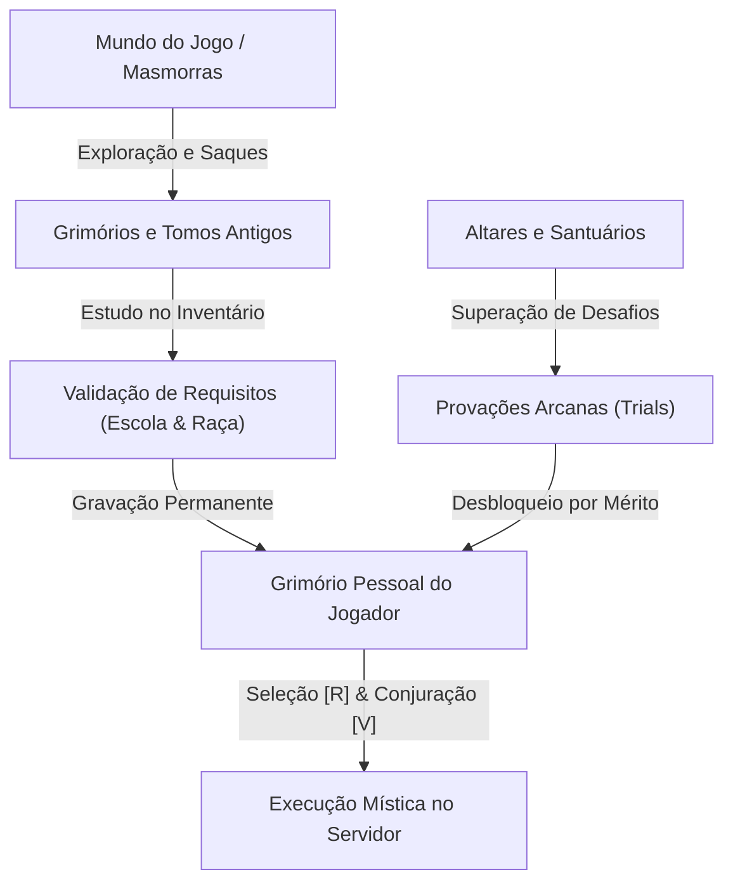

# CAOS ARCANA — MATRIZ OFICIAL DE BALANCEAMENTO RACIAL E MÁGICO

**Versão do Documento:** 1.0.0-PROD  
**Data:** 27 de Outubro de 2026  
**Ambiente Técnico:** Minecraft 1.20.1 / Fabric Loader 0.20.1 / Java 17  
**Filosofia Central:** *"A raça define a identidade inicial e a linhagem ancestral do personagem, mas não determina completamente o seu destino."*

---

## 1. Princípios Norteadores de Balanceamento

Antes de qualquer ajuste numérico, o design de sistemas do Caos Arcana submete todas as regras aos seguintes 4 princípios fundamentais:

> [!IMPORTANT]
> **Princípio 1 — Poder permanente não anula sobrevivência:** Nenhuma característica racial inata pode substituir integralmente uma mecânica clássica de sobrevivência do Minecraft. O Argoniano respira por mais tempo, mas não é um submarino eterno sem preparo; o Dunmer resiste ao calor, mas a lava do Nether continua sendo letal se houver imprudência.

> [!IMPORTANT]
> **Princípio 2 — Todo poder ativo exige cooldown e contrajogo:** Habilidades ativas como a *Ira Berserker* ou a *Pele de Hist* não podem ser botões de invencibilidade sem custo. Elas exigem tempo de recarga expressivo (20s a 45s), janelas de ação delimitadas e momentos de vulnerabilidade ou exaustão que permitam aos adversários reagir taticamente.

> [!IMPORTANT]
> **Princípio 3 — Nenhuma raça é obrigatória para uma masmorra:** Masmorras aquáticas, fortalezas de cinzas ou catacumbas gélidas podem ser mais acessíveis a certas raças, mas **sempre** existirão alternativas equivalentes via grimórios universais, poções da alquimia ou equipamentos forjados para que qualquer personagem vença qualquer desafio.

> [!IMPORTANT]
> **Princípio 4 — Separação estrita entre PvP e PvE:** Vantagens aceitáveis contra hordas de monstros pré-programados (como pacificação de feras ou repulsão) não podem desestabilizar o combate competitivo entre jogadores. As mecânicas possuem tratamento diferenciado entre entidades de inteligência artificial e jogadores humanos.

---

## 2. Matriz Comparativa Quantitativa das 10 Raças

Valores medidos no motor do jogo com base vanilla de referência:
* **Vida Base Vanilla:** 20.0 HP (10 corações vermelhos).
* **Velocidade Base Vanilla:** 0.100 (passo terrestre padrão).
* **Dano de Ataque Físico Base:** 1.0 (soco desarmado).
* **Armadura Natural Base:** 0.0 pontos.
* **Mana Base:** 100 pontos | **Regeneração Base:** 2.0 pontos/segundo.

| Raça | Vida Máxima | Dano Base | Velocidade | Armadura | Mana Máx. | Regen Mana | Potencial de Conjuração (PPM)* |
| :--- | :---: | :---: | :---: | :---: | :---: | :---: | :---: |
| **Orc** | **24.0** (+4) | **3.0** (+2) | **0.090** (-10%)| **2.0** (+2) | 100 | **1.5/s** | 4.5 centelhas/min |
| **Felino (Khajiit)** | **18.0** (-2) | 1.0 (+3 garras)| **0.115** (+15%)| 0.0 | 100 | 2.0/s | 6.0 centelhas/min |
| **Alto Elfo (Altmer)** | **18.0** (-2) | 0.85 (-15%) | 0.100 (base) | 0.0 | **150** (+50)| **3.0/s** | **9.0 centelhas/min** |
| **Nórdico** | **22.0** (+2) | **2.0** (+1) | 0.100 (base) | 0.0 | 100 | 2.0/s | 6.0 centelhas/min |
| **Elfo Negro (Dunmer)**| 20.0 (base) | 1.0 (base) | 0.100 (base) | **1.0** (+1) | **120** (+20)| **2.2/s** | 6.6 centelhas/min |
| **Elfo da Floresta** | **18.0** (-2) | 1.0 (base) | **0.110** (+10%)| 0.0 | **110** (+10)| 2.0/s | 6.0 centelhas/min |
| **Bretão** | 20.0 (base) | 1.0 (base) | 0.100 (base) | **1.0** (+1) | **125** (+25)| **2.5/s** | 7.5 centelhas/min |
| **Imperial** | 20.0 (base) | 1.0 (base) | 0.100 (base) | **1.0** (+1) | **110** (+10)| 2.0/s | 6.0 centelhas/min |
| **Guarda Vermelho** | 20.0 (base) | **2.0** (+1) | **0.105** (+5%) | 0.0 | 100 | 1.8/s | 5.4 centelhas/min |
| **Argoniano** | 20.0 (base) | 1.0 (base) | 0.100 (base) | **2.0** (+2) | 100 | 2.0/s | 6.0 centelhas/min |

*\*PPM (Potencial de Conjuração por Minuto): Quantidade máxima contínua de feitiços de primeiro círculo (custo 20 mana) sustentados exclusivamente pela regeneração natural da raça por 60 segundos.*

---

## 3. Desempenho e Sobrevivência Ambiental

| Raça | Superfície e Cavernas | Exploração Subaquática | Dimensão do Nether |
| :--- | :--- | :--- | :--- |
| **Orc** | Excelente resistência a dano físico e quedas de blocos; sofre com menor mobilidade em perseguições. | Regular; afunda com facilidade devido ao peso de armaduras e não possui adaptação pulmonar. | Regular; vulnerável ao calor acumulado e ghasts à distância, mas esmaga piglins no corpo a corpo. |
| **Felino** | Superior; maior raio de varredura terrestre, visão no escuro sem tochas e rápida fuga de emboscadas. | Baixo; penalidade psicológica/física em água profunda, dependente de botes e poções. | Alto; agilidade para desviar de projéteis de blaze e transitar por pontes estreitas de basalto. |
| **Alto Elfo** | Médio; frágil contra arqueiros e ataques surpresa, mas domina salas inteiras à distância com magias. | Regular; necessita de feitiços de Alteração (*Luz de Vela*, *Respiração*) para explorar fossas. | Alto; ampla reserva mágica permite combater fortalezas à distância, mas vulnerável se encurralado. |
| **Nórdico** | Alto; tenaz em biomas de montanha e neve profunda; anula o congelamento severo do Minecraft. | Médio; resistente ao choque térmico de oceanos congelados, sem bônus de oxigênio. | Regular; não sofre efeitos colaterais de frio, mas não possui bônus contra chamas. |
| **Elfo Negro** | Alto; adaptabilidade tanto em combate marcial quanto mágico; armadura natural ajuda em minas. | Regular; comportamento padrão em ambientes aquáticos. | **Superior;** extingue chamas na metade do tempo e resiste ao calor; lava ainda causa dano se imerso. |
| **Elfo Floresta**| Superior em selvas e florestas; imune a veneno de aranhas de caverna e tiros de toxina de bruxas. | Regular; mobilidade ágil nas margens de rios e lagos. | Médio; alta precisão com arcos contra ghasts, mas frágil se atingido por explosões. |
| **Bretão** | Alto; a absorção mágica permanente protege contra bruxas, invocações e ataques arcanos em dungeons. | Regular; comportamento padrão. | Alto; barreira mágica atenua significativamente o dano de fogo místico e feitiços de criaturas abissais. |
| **Imperial** | Alto; armadura equilibrada e bônus passivo de moedas e joias em baús de tesouros de minas e vilas. | Regular; comportamento padrão. | Regular; encontra maior valor de espólios em fortalezas do Nether, mas combate padrão. |
| **Guarda Verm.**| Superior em terreno aberto e desértico; saturação lenta permite longas viagens de sprint contínuo. | Regular; comportamento padrão. | Alto; reflexos rápidos e vigor constante para esquivar de wither skeletons e piglins brutais. |
| **Argoniano** | Alto em pântanos e selvas úmidas; armadura de escamas protege contra picadas e mordidas. | **Superior;** fôlego 3x mais longo e nado ágil com sprint ativo; não anula o perigo de templos marítimos. | Baixo; sangue frio sofre dano amplificado em temperaturas extremas de fogo e cinzas. |

---

## 4. Análise de Combate: Poderes Raciais, Cooldowns e Contrajogo

### 1. Orc — Ira Berserker (`caosarcana:ira_berserker`)
* **Efeito:** Concede Força I (+3 dano) e Resistência I (-20% dano sofrido) por 12 segundos.
* **Custo & Recarga:** 35 Mana | 30 segundos de cooldown (600 ticks).
* **Vantagem PvP / PvE:** Vira lutas perdidas no corpo a corpo em momentos de desespero; esmaga alvos lentos.
* **Janela de Contrajogo:** Manter distância durante os 12 segundos usando arcos, feitiços de gelo (*Geada Congelante*) ou repulsão. O Orc não ganha velocidade na fúria e gasta 35% de sua mana base.

### 2. Khajiit (Felino) — Olhos da Noite (`caosarcana:olhos_da_noite`)
* **Efeito:** Concede Visão Noturna total cristalina por 60 segundos.
* **Custo & Recarga:** 15 Mana | 10 segundos de cooldown (200 ticks).
* **Vantagem PvP / PvE:** Exploração impecável de cavernas profundas sem alertar monstros com tochas; perseguição noturna.
* **Janela de Contrajogo:** Uso de magias luminosas (*Luz de Vela* ou fogo) que revelam sua silhueta; o Felino possui 2 HP a menos (1 coração), sendo vulnerável a golpes críticos pesados.

### 3. Alto Elfo — Nobreza Arcana (`caosarcana:nobreza_arcana`)
* **Efeito:** Restaura imediatamente 40 pontos de Mana e concede Regeneração I por 10 segundos.
* **Custo & Recarga:** 10 Mana Líquido | 40 segundos de cooldown (800 ticks).
* **Vantagem PvP / PvE:** Concede um "segundo fôlego" mágico, permitindo manter o bombardeio arcano ininterrupto.
* **Janela de Contrajogo:** Interromper a conjuração colando no corpo a corpo. O Alto Elfo tem dano físico reduzido (-15%) e -2 HP, não sustentando combate físico prolongado.

### 4. Nórdico — Grito de Batalha (`caosarcana:grito_de_batalha`)
* **Efeito:** Onda de choque sônica em raio de 8 blocos que repele todos os inimigos e aplica Fraqueza e Lentidão por 8 segundos.
* **Custo & Recarga:** 25 Mana | 25 segundos de cooldown (500 ticks).
* **Vantagem PvP / PvE:** Desengajamento perfeito quando cercado por monstros ou encurralado por assassinos ágeis.
* **Janela de Contrajogo:** Aproximar-se novamente com ataques à distância ou ataques com aríete/espada vinculada logo após o grito ser gasto.

### 5. Elfo Negro — Ira Ancestral (`caosarcana:ira_ancestral`)
* **Efeito:** Cria uma tempestade de fogo e cinzas em raio de 5 blocos, incendiando atacantes por 6 segundos e causando dano contínuo, além de Resistência a Fogo por 20s.
* **Custo & Recarga:** 30 Mana | 30 segundos de cooldown (600 ticks).
* **Vantagem PvP / PvE:** Punição extrema contra oponentes corpo a corpo que tentam cercá-lo.
* **Janela de Contrajogo:** Atacar com feitiços de Criomancia (*Geada Congelante*), explorando sua vulnerabilidade elemental a frio.

### 6. Elfo da Floresta — Comunhão Selvagem (`caosarcana:comunhao_selvagem`)
* **Efeito:** Em 12 blocos, pacifica feras e remove o alvo de monstros agressivos, concedendo Velocidade I ao Bosmer por 15s.
* **Custo & Recarga:** 20 Mana | 20 segundos de cooldown (400 ticks).
* **Vantagem PvP / PvE:** Controle de multidões instantâneo em dungeons cheias de mobs; reset de agressão.
* **Janela de Contrajogo em PvP:** Em combate entre jogadores, o efeito não desarma o jogador oponente, concedendo apenas a mobilidade temporária. Disparos com arco anulam sua velocidade.

### 7. Bretão — Pele de Dragão (`caosarcana:pele_de_dragao`)
* **Efeito:** Absorve 40% do impacto místico recebido, converte em 25 pontos de Mana instantâneos e ativa Resistência I por 15s.
* **Custo & Recarga:** 40 Mana | 35 segundos de cooldown (700 ticks).
* **Vantagem PvP / PvE:** O contra-ataque definitivo contra magos puros; ganha recurso enquanto é atacado por magia.
* **Janela de Contrajogo:** Mudar o padrão de ataque imediatamente para dano físico puro (machado, espada comum ou flechas convencionais), onde as defesas feéricas não geram mana.

### 8. Imperial — Voz do Imperador (`caosarcana:voz_do_imperador`)
* **Efeito:** Acalma o combate em 10 blocos removendo alvos de mobs e concede Herói da Vila por 15 segundos (calibrado).
* **Custo & Recarga:** 25 Mana | 25 segundos de cooldown (500 ticks).
* **Vantagem PvP / PvE:** Saída diplomática de situações mortais e melhores negociações comerciais.
* **Janela de Contrajogo:** Duração reduzida para 15 segundos impede exploração econômica de trocas infinitas. Em PvP, não impede que jogadores continuem o ataque físico.

### 9. Guarda Vermelho — Ímpeto de Adrenalina (`caosarcana:impeto_de_adrenalina`)
* **Efeito:** Restaura imediatamente 8 pontos de fome/saturação e ativa Velocidade II e Pressa II por 15 segundos.
* **Custo & Recarga:** 20 Mana | 25 segundos de cooldown (500 ticks).
* **Vantagem PvP / PvE:** Explosão marcial com cadência implacável de golpes com espada e recuperação de fôlego.
* **Janela de Contrajogo:** Uso de barreiras físicas (escudo), magias de lentidão ou armadilhas de terreno para gastar os 15 segundos da aceleração sem sofrer dano direto.

### 10. Argoniano — Pele de Hist (`caosarcana:pele_de_hist`)
* **Efeito:** Invoca a bênção da árvore Hist, ativando Regeneração II por 8 segundos e Absorção por 12 segundos.
* **Custo & Recarga:** 30 Mana | 30 segundos de cooldown (600 ticks).
* **Vantagem PvP / PvE:** Sobrevivência extrema em situações de quase morte em dungeons ou emboscadas.
* **Janela de Contrajogo:** Aplicação de dano em rajada (*burst damage*) de alto impacto ou uso de fogo contínuo para sobrepujar a taxa de regeneração por segundo.

---

## 5. Sinergias Raciais com as 10 Magias Universais

| Magia Universal | Escola / Círculo | Melhor Sinergia Racial | Razão Tática da Sinergia |
| :--- | :--- | :--- | :--- |
| **Centelha Ígnea** | Piromancia (Destruição 1) | **Elfo Negro (Dunmer)** | Bônus temático em magias de fogo; queima inimigos enquanto sua passiva os mantém afastados. |
| **Geada Congelante** | Criomancia (Destruição 1) | **Nórdico** | Compensação da afinidade reduzida com fogo; permite ao guerreiro desacelerar alvos e alcançá-los. |
| **Relâmpago Arcano** | Eletromancia (Destruição 2) | **Alto Elfo** | Custo de 28 mana sustentado perfeitamente pelos 3.0/s de regeneração dos Altmer. |
| **Toque de Cura** | Restauração 1 | **Orc & Nórdico** | Permite aos guerreiros pesados recuperarem seus corações extras sem depender exclusivamente de poções. |
| **Círculo Sagrado** | Restauração 2 | **Imperial & Bretão** | Cria fortalezas táticas para repelir mortos-vivos enquanto protegem o grupo em dungeons. |
| **Corpo de Carvalho** | Alteração 1 | **Felino & Bosmer** | Compensa a penalidade de -2 HP dessas raças, concedendo a armadura necessária para incursões arriscadas. |
| **Luz de Vela** | Alteração 1 | **Argoniano & Bretão** | Iluminação móvel subaquática ou em túneis escuros sem gastar a mão secundária com tochas. |
| **Espada Vinculada** | Conjuração 1 | **Guarda Vermelho** | Combina a velocidade de ataque marcial natural do Redguard com uma lâmina de alta penetração. |
| **Familiar Espectral** | Conjuração 2 | **Elfo da Floresta** | O espírito lupino complementa o combate à distância do arqueiro, segurando os monstros na linha de frente. |
| **Manto de Sombras** | Ilusão 1 | **Khajiit (Felino)** | Combinação letal de furtividade total com os passos velozes e garras afiadas para assassinatos limpos. |

---

## 6. Papel Definido para Aquisição de Conhecimento

1. **Dungeons e Estruturas:** Fonte primária de descoberta de grimórios físicos raros e moedas econômicas.
2. **Provações Arcanas (Trials):** Rituais e testes de mérito onde o jogador prova o domínio prático de um elemento (derrotando alvos específicos, sobrevivendo a condições adversas ou interagindo com santuários).
3. **Grimórios:** O veículo tangível de transmissão do conhecimento. Clicar com botão direito abre a tela de estudo; se o jogador atender ao nível da escola, grava a magia na alma permanentemente.
4. **Nível da Escola Arcana:** Medidor de proficiência do personagem que impede conjuradores novatos de estudarem ou lançarem feitiços avançados sem treino prévio.

---

## 7. Garantias Técnicas de Segurança e Idempotência

1. **Comando de Provação Restrito a Administradores:**  
   O comando `/caos provacao concluir <id>` exige formalmente `requires(source -> source.hasPermission(2))` no Brigadier Dispatcher. Jogadores sem cargo de operador recebem erro de comando desconhecido ou permissão insuficiente.
2. **Prevenção de Duplicação e Exploração de Grimórios:**  
   O manipulador [`GrimoireStudyHandler`](file:///c:/Users/Matt/Desktop/modpacknovo/caos-arcana-mod/src/main/java/br/com/caosarcana/content/spells/GrimoireStudyHandler.java) verifica `caosarcana$knowsSpell(id)` antes de qualquer ação. Se o personagem já conhece a magia, o livro não é consumido, nenhuma recompensa é duplicada e o sistema apenas emite som de folhear páginas com aviso amigável.
3. **Persistência Após Morte:**  
   O evento `ServerPlayerEvents.COPY_FROM` preserva 100% da lista de magias aprendidas, nível de escolas, raça e mana máxima após o renascimento. Apenas os itens físicos do inventário caem no local do óbito.

---

## 8. Esclarecimentos de Engenharia e Status de Homologação

Para manter a integridade documental e alinhar expectativas entre Game Design e Engenharia:

### A. Registro de Provação vs. Provação Jogável no Mundo
* **Implementado:** A camada lógica [`ArcaneTrialRegistry`](file:///c:/Users/Matt/Desktop/modpacknovo/caos-arcana-mod/src/main/java/br/com/caosarcana/content/trials/ArcaneTrialRegistry.java) estabelece as 10 provações, requisitos de escola, textos de missão e contratos de concessão no servidor.
* **Pendente para Homologação:** A geração procedural de santuários no mundo físico e os gatilhos autônomos de vitória (sem intervenção de comando administrativo) pertencem ao marco seguinte de geração de estruturas e missões.

### B. Poder Cadastrado vs. Poder Balanceado em Multiplayer
* **Implementado:** As 10 raças possuem atributos reais vinculados à API de atributos vanilla e poderes com cooldowns e custos registrados no [`SpellRegistry`](file:///c:/Users/Matt/Desktop/modpacknovo/caos-arcana-mod/src/main/java/br/com/caosarcana/content/spells/SpellRegistry.java).
* **Pendente para Homologação:** Os números atuais são valores de referência calibrados. O balanceamento definitivo requer sessões de combate PvP/PvE em servidor multiplayer dedicado com latência de rede e equipamentos empilhados.

### C. Demonstração Matemática e Implementação do Fôlego do Argoniano
* **Mecânica Vanilla:** Uma entidade submersa possui 300 ticks de ar (10 bolhas) e consome 1 tick de ar a cada tick de simulação (20 ticks por segundo, totalizando 15,0s para esgotar o reservatório de ar). Quando o reservatório chega a 0, decorrem mais 20 ticks (1,0s) em ar negativo até -20, momento em que o primeiro dano de afogamento (2.0F) é aplicado. Tempo total vanilla até primeiro dano: 320 ticks (16,0s).
* **Diagnóstico da Implementação Anterior:** A reposição de +1 tick a cada 20 ticks no `END_SERVER_TICK` apenas reduzia o consumo de 20 para 19 ticks/s ($300 / 19 \approx 15,79s$), um ganho irrisório de 0,79s (5,26%). Além disso, a documentação prévia continha aproximações como uma alternância entre +13 e +14 que geraria média 13,5 pontos/s (e não 13,33 pontos/s), além de produzir saltos visuais descontínuos a cada segundo.
* **Implementação Realizada (`LivingEntityRPGMixin`):** Em vez de saltos discretos a cada segundo, intercepta-se a chamada de consumo natural `LivingEntity.decreaseAirSupply(int air)` na thread de física do jogo. O consumo é suprimido quando `tickCount % 3 != 0`, consumindo ar apenas 1 vez a cada 3 ticks de simulação:
  - **Tempo de esgotamento do reservatório:** $300 \times 3 = 900\text{ ticks}$ (**45,0 segundos**, exatamente $3,0\times$ o vanilla).
  - **Tempo até o primeiro dano por afogamento:** $900 + (20 \times 3) = 960\text{ ticks}$ (**48,0 segundos**, exatamente $3,0\times$ o vanilla).
  - **Preservação de mecânicas:** Recuperação fora d'água (`increaseAirSupply`) permanece 100% inalterada, poções de Respiração Aquática são respeitadas, e encantamentos de Respiração (Respiration) empilham de forma limpa e multiplicativa.

### D. Política de Recargas Desacoplada e Persistente
* **Desacoplamento Completo:** O cooldown não é mais vinculado ao item `ModItems.CENTELHA_IGNEA`. Cada feitiço e poder racial possui seu próprio registro em `caosarcana$spellCooldowns` indexado por ID textual.
* **Global Cooldown (GCD):** Não foi implementado nenhum bloqueio global obrigatório, preservando fluidez tática entre conjurações independentes.
* **Persistência Anti-Exploit:** As recargas ativas são serializadas em NBT (`CompoundTag SpellCooldowns`) e preservadas no evento `ServerPlayerEvents.COPY_FROM`. Jogadores não conseguem burlar tempos de recarga de habilidades de alto impacto cometendo suicídio tático.

### E. Ciclo de Vida e Anti-Farm do Familiar Espectral
* **Implementação Realizada (`SpellCastHandler`, `SpectralWolfMixin`, `LivingEntityRPGMixin`):**
  - **Validação Atômica:** A entidade é instanciada e validada antes de debitar mana ou recarga. Se a instanciação falhar, o conjurador não é cobrado e o familiar prévio é mantido intacto.
  - **Unicidade Estrita:** Cada conjurador possui no máximo 1 familiar ativo rastreado por UUID (`caosarcana$getActiveFamiliarId()`). Invocação subsequente dissipa com segurança a anterior com partículas de fumaça.
  - **Ciclo Temporal:** Duração máxima de 1200 ticks de simulação (60 segundos). Ao expirar, a entidade é descartada (`discard()`) com efeito sonoro e visual.
  - **Tratamento de Desconexão, Morte e Descarregamento de Chunk:** O vínculo é desfeito na desconexão (`ServerPlayConnectionEvents.DISCONNECT`) e na morte do conjurador (`ServerPlayerEvents.COPY_FROM`). Se um familiar estiver em chunk descarregado e acordar posteriormente, ao verificar que seu dono está offline ou que o UUID do familiar ativo mudou, executa auto-anulação imediata sem carregar chunks desnecessariamente.
  - **Proteção Anti-Farm / Anti-Exploit:** Interceptação em `SpectralWolfMixin` e `LivingEntityRPGMixin` impede reprodução (`canMate` e `isFood` retornam falso), cancela geração de esferas de experiência (`shouldDropExperience` retorna falso) e anula qualquer drop de tabela de itens (`shouldDropLoot` retorna falso).

### F. Salvaguardas de Linha de Visada (Geada e Relâmpago)
* **Geada Congelante:** O cone cessa sua propagação ao colidir com o primeiro bloco sólido (`ClipContext.Block.COLLIDER`). Para impedir vazamento periférico por caixas de amostragem (AABB) através de portas ou paredes finas, cada alvo candidato passa por verificação estrita de linha de visada (`level.clip`) entre os olhos do conjurador e os olhos do alvo. Múltiplos alvos únicos podem ser atingidos ao longo do trajeto (máximo 1 acerto por entidade por conjuração).
* **Relâmpago Arcano:** O raio linear focado ordena todos os alvos candidatos pela distância real à origem do conjurador, valida a linha de visada contra obstruções e atinge estritamente o primeiro alvo da linha, cessando o percurso imediatamente (`break;`). Dano (8.0F), alcance (24 blocos) e custo (28 Mana) foram rigorosamente preservados.

---

## 9. Consolidação dos Resultados da Homologação Prática (Rodada do Usuário)

Resultados dos testes manuais in-game executados pelo usuário com o JAR de hash `A18188DA...`:

| Subsistema / Cenário de Teste | Status Homologado | Evidência / Observações Registradas |
| :--- | :---: | :--- |
| **Recargas Independentes (Poder Racial vs. Universal)** | **APROVADO** | Aprovação manual informada pelo usuário. Disparo de feitiços universais não bloqueado por poder racial e persistência confirmada. |
| **Persistência de Recargas Após Morte** | **APROVADO** | Aprovação manual informada pelo usuário. Recargas não são zeradas por suicídio tático (`/kill`). |
| **Familiar: Invocação e Expiração (1200 ticks)** | **APROVADO** | Aprovação manual informada pelo usuário. Entidade surge com efeito visual e dissipa ao término da contagem de simulação. |
| **Familiar: Substituição Após Fim da Recarga** | **APROVADO** | Aprovação manual informada pelo usuário. Nova invocação confirmada substitui a anterior no mundo sem duplicar entidades. |
| **Familiar: Falta de Mana com Recarga Pronta** | **APROVADO** | Aprovação manual informada pelo usuário. Bloqueio correto por mana sem descartar nem prejudicar o familiar ativo prévio. |
| **Familiar: Dissipação por Morte e Desconexão** | **APROVADO** | Aprovação manual informada pelo usuário. Entidade descartada no servidor sem deixar familiares órfãos. |
| **Familiar: Anti-Farm (Reprodução, Loot e XP)** | **APROVADO** | Aprovação manual informada pelo usuário. Bloqueio de reprodução/comida e anulação total de drops e esferas de XP confirmados. |
| **Raios: Bloqueio por Parede Sólida e Porta Fechada** | **APROVADO** | Aprovação manual informada pelo usuário. Partículas colidem e alvos atrás da barreira não sofrem dano ou efeitos. |
| **Raios: Salvaguarda de Borda/Quina Externa** | **APROVADO** | Aprovação manual informada pelo usuário. Sem vazamento periférico por caixas de colisão volumétrica. |
| **Raios: Múltiplos Alvos (Geada vs. Relâmpago)** | **APROVADO** | Aprovação manual informada pelo usuário. Geada atinge cada alvo uma única vez no cone; Relâmpago cessa no primeiro alvo válido. |
| **Fôlego do Argoniano: Redução de Consumo a 1/3** | **APROVADO** | Aprovação manual informada pelo usuário. Consumo de ar contínuo mais lento comparado ao controle, recuperação normal fora d'água e compatibilidade com encantamentos/poções. *(Sem registro de números artificiais não medidos).* |
| **Familiar: Descarregamento Real de Chunk e Retorno** | **PENDENTE** | **Mantido como pendente.** Requer comprovação específica de descarregamento efetivo de chunks no servidor dedicado/singleplayer e permanência física do familiar no local. |
